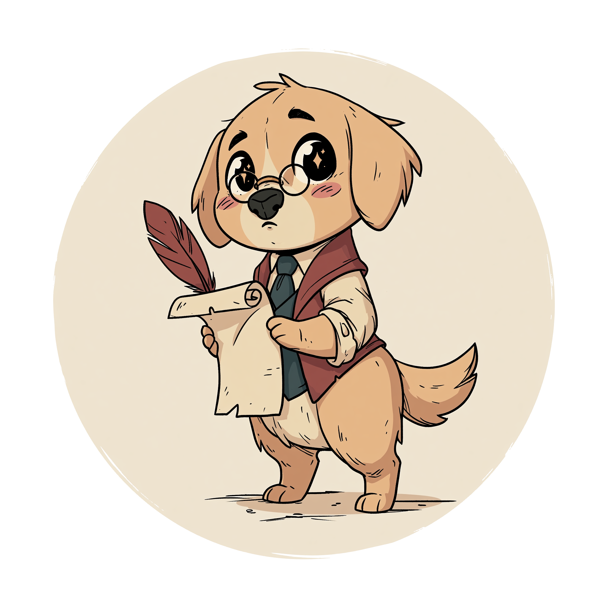
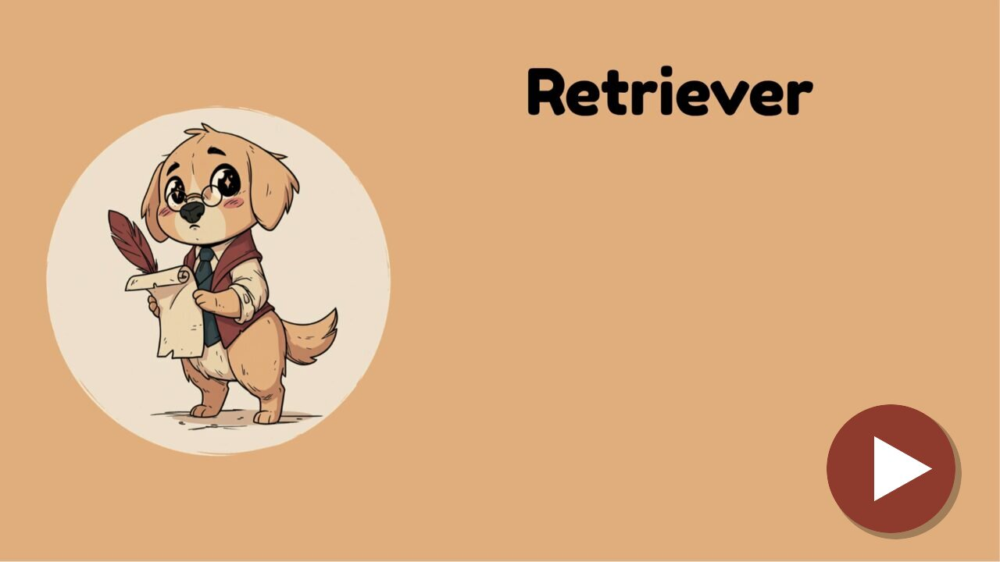
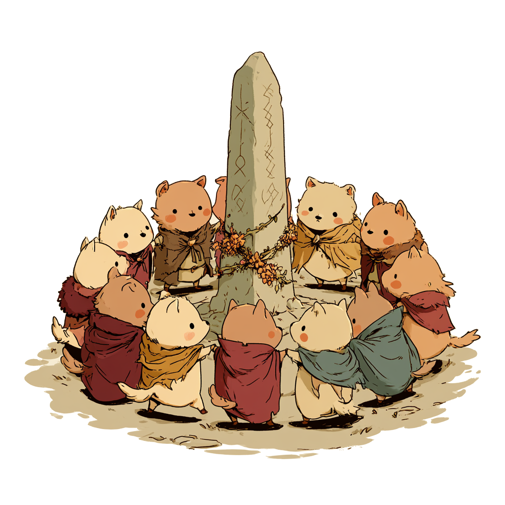
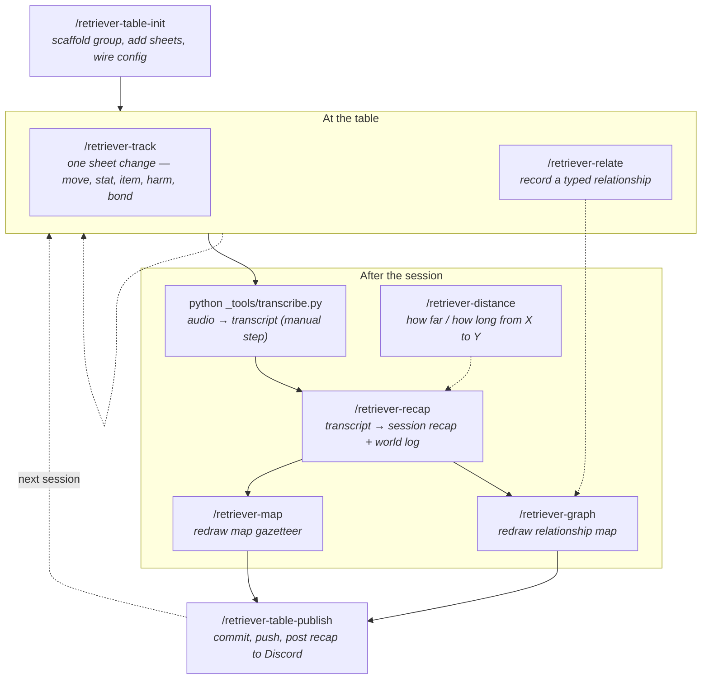
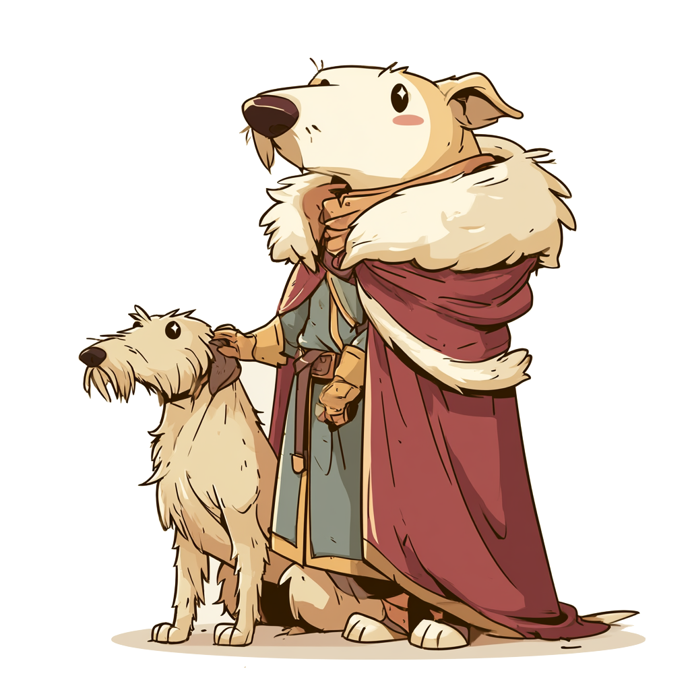
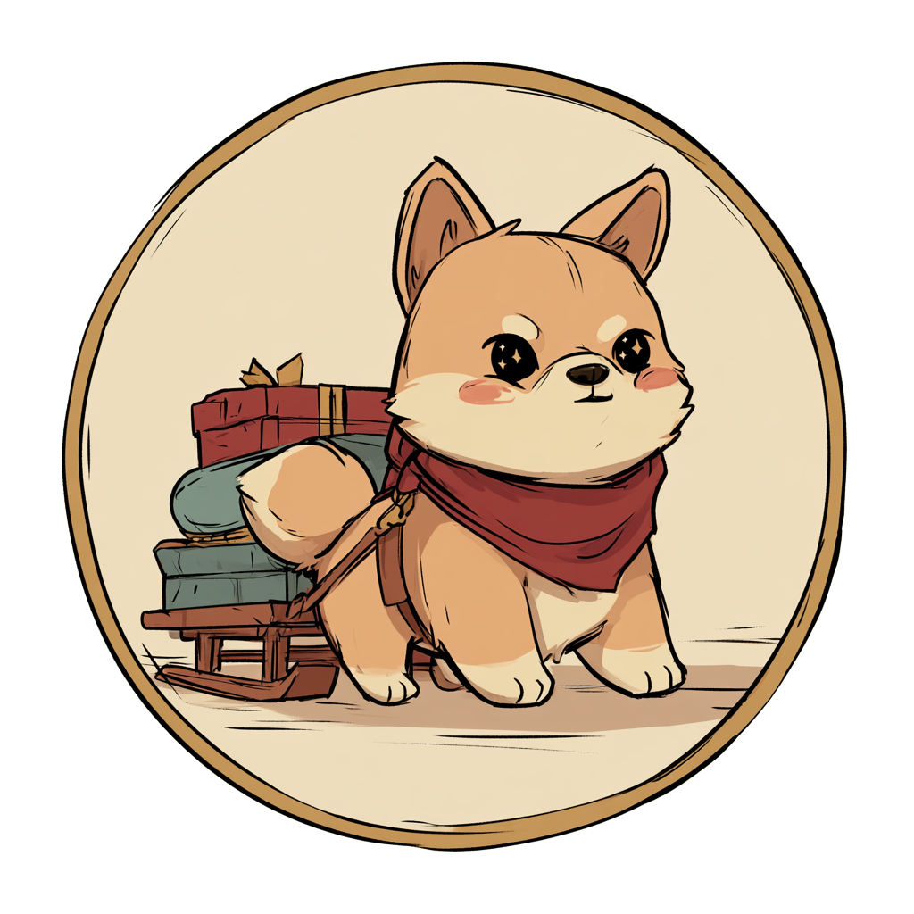
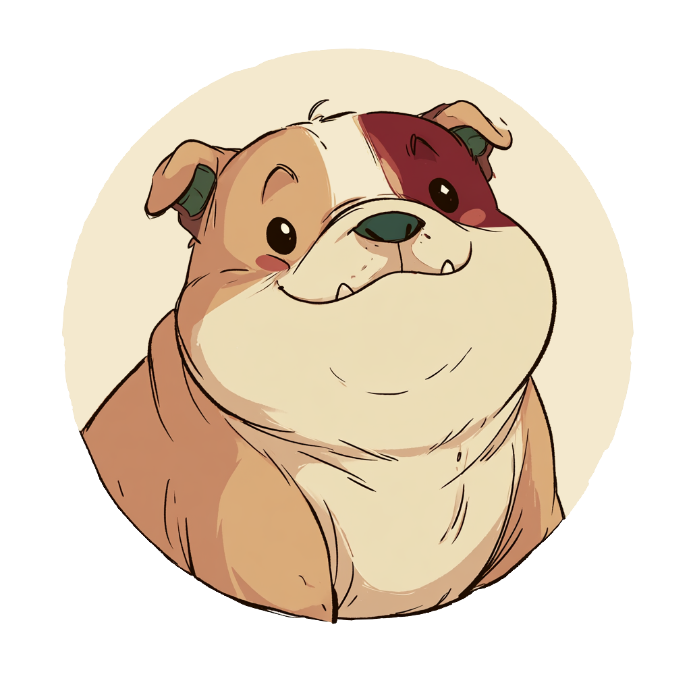

  

<h1 align="center"><a href="https://puppup.games">Retriever</a> — an Obsidian Campaign Kit</h1>

<em>Fetch, don't fumble. Silly games for serious fun.</em>

  
  

**Retriever** is the machinery for **bootstrapping and running** a tabletop campaign — an Obsidian-ready notes vault plus a set of Claude Code skills that maintain player sheets, session recaps, a world log, a keyed map gazetteer, and a typed relationship map. It's the organiser that keeps a table tidy, not adventure text.

> **Systems.** Retriever ships a **Stonetop** toolkit today — compatible with _Stonetop_ by Jeremy Strandberg — and is built to grow: **support for other systems is planned.** For playable Stonetop modules and expeditions, use [Sled Dog](https://sleddog.tools): the GM switches them on under the party's **Settings → Unofficial Content** (free accounts included).

Everything here is released under [CC BY-SA 4.0](LICENSE): read it, run it at your table, share it, remix it.

> **Unofficial, fan-made work.** Not affiliated with, endorsed by, or sponsored by Lampblack & Brimstone or Jeremy Strandberg. These tools contain no copyrighted Stonetop text — only empty note templates, code, and placeholder maps. Bring your own copy of the book and your own campaign.

   
  <em>▶ <a href="https://youtu.be/aKYVmUrCpUg">Watch the overview</a>: how Retriever runs a campaign, from the table to Discord.</em>

---

## Session kit (run your own table)

A reusable toolkit for *running* a campaign — an Obsidian-ready notes vault plus a set of Claude Code skills that maintain player sheets, session recaps, a world log, and a typed relationship map of everyone the party has met.

- **[session-kit/](session-kit/)** — clone this repo, run `python session-kit/bootstrap.py --target ../my-campaign --group <name>`, and you get a ready-to-run session repo.

 

### Skills workflow

The session kit is a set of Claude Code `/slash` skills that carry a campaign from setup through each session's publish. The skills parse your plain-language instructions and write recap prose; every actual file change is made by a deterministic script in `_tools/`. This is the lifecycle:

Solid arrows are the usual path; dashed arrows are repeat-as-needed or optional steps. `/retriever-distance` is a query skill you can run any time at the table or in prep. See [session-kit/repo-template/.claude/README.md](session-kit/repo-template/.claude/README.md) for the full per-skill reference.

## Maps

Editable Inkscape map templates for the steading and its vicinity, designed to pair with the session kit. The copyrighted published maps are not included — you drop the map from your own copy of _Stonetop_ into the template's base layer and keep the numbered key layer on top.

- **[Map templates](maps/)** — `stonetop-steading-template.svg` and `the-vicinity-template.svg`, with usage notes.

 

## Play it in Sled Dog

  

Bring your campaign to the table with **[Sled Dog](https://sleddog.tools)** — our Stonetop companion app for character sheets, arcana, and your steading. Retriever keeps the GM's notes; Sled Dog is the players' half.

  

## License & AI disclosure

See [LICENSE](LICENSE) for the CC BY-SA 4.0 grant and required Stonetop attribution, and [AI-DISCLOSURE.md](AI-DISCLOSURE.md) for how AI tools were used in making this material.

---

 
  <em>Pup Pup Games. Silly games for serious fun.</em>

